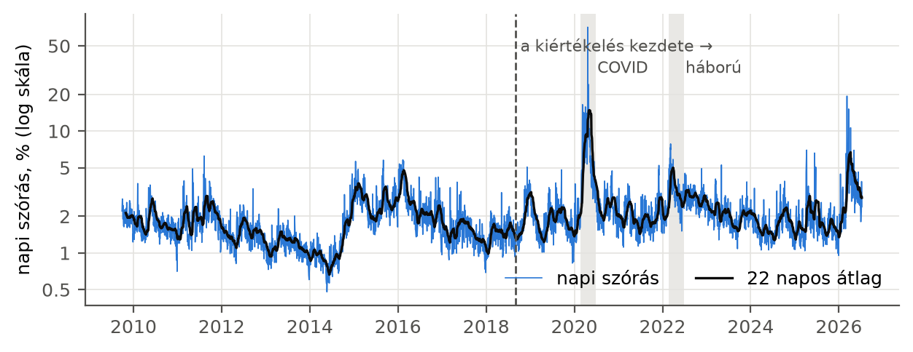
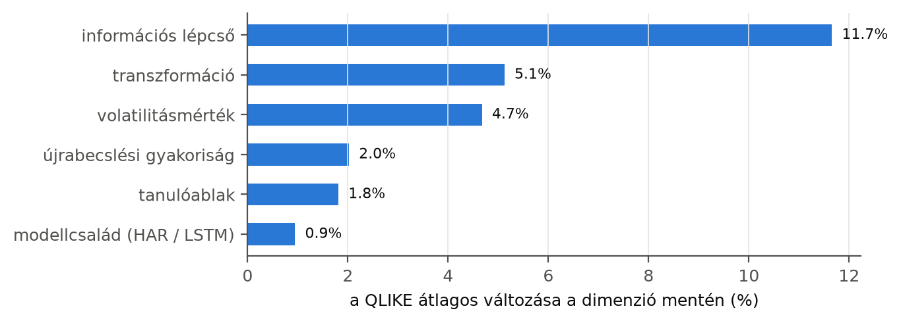

# Measurement, Information or Model? Forecasting WTI Crude Oil Volatility

**Controlled comparison of 256 HAR-X and hybrid HAR-X–LSTM models for next-day WTI crude oil volatility.**

Research paper for the Scientific Students' Conference (TDK) at Corvinus University of Budapest, 2026.
Author: Tamas Gyorgy · Supervisor: Dr. Zsolt Bihary · Hungarian version of this README: [README_HU.md](README_HU.md)



## Research question

What drives the accuracy of a volatility forecast – **the measurement** of volatility, **the information** given to
the model, or **the model** itself? The literature studies these separately, on different markets, targets and loss
functions. This project isolates each factor in a single controlled design on the WTI market.

## Design

Every model forecasts the same target – next-day WTI daily volatility – on the same **1,841-day out-of-sample period**
(30 Aug 2018 – 9 Jul 2026), with the same loss function. The factorial grid:

| Dimension | Levels |
|---|---|
| Model family | HAR-X (OLS) · hybrid HAR-X + LSTM correction |
| Information layer | L1 HAR terms · L2 + market (OVX, VIX, S&P 500, USD) · L3 + commodities · L4 + GDELT news |
| Volatility measure | Realized variance (RV) · jump-robust RV-CJ · Parkinson · Garman–Klass (from 5-minute bars) |
| Transformation | log · quartic root |
| Training window | 2 years · 3 years (rolling) |
| Refit frequency | weekly · monthly |

2 × 4 × 4 × 2 × 2 × 2 = **256 models**. Evaluation uses QLIKE, out-of-sample R², pairwise and joint
Giacomini–White tests and the Model Confidence Set, with hypotheses and decision rules fixed before evaluation.

**Data:** NYMEX WTI crude oil futures, 5-minute bars, 2009–2026 (1.19M bars, 4,168 valid trading days), plus daily
market, commodity and GDELT news data. All features follow a strict point-in-time rule: only information available
before the 17:00 ET forecast time is used.

## Key findings

- **The best model cuts forecast error by 24%** versus a naive "tomorrow equals today" forecast.
  Roughly half of the gain comes from **measurement**, two-fifths from **external information**, and a tenth from the HAR structure.
- **Measurement matters:** range-based measures (Parkinson, Garman–Klass) aggregated from 5-minute bars are never worse
  than realized variance and are significantly better in **95% of 128 model pairs** – in every year of the sample.
- **Information matters, mostly from one source and mostly in crises:** almost all of the gain comes from the market layer,
  above all oil implied volatility (OVX), which cut forecast errors by **27% during COVID-19**.
- **Model complexity does not matter:** the LSTM correction does not significantly improve on HAR-X in any model pair.
  A stand-alone LSTM without the HAR-X anchor is worse than the naive forecast.
- **"Technical" choices are not technical:** the transformation matters as much as the volatility measure – log beats the
  quartic root in every pair, by 5.3% on average.



## Repository structure

| Path | Content |
|---|---|
| `src/` | shared, tested engine: measures, external data, inputs, rolling forecasting, HAR, LSTM, evaluation |
| `models/<Family>_<Layer>/<Transform>/<Window>_<Refit>/<Measure>/` | **one folder = one model**: `model.py`, `forecasts.csv`, `metrics.csv` |
| `scripts/` | full pipeline in run order (`00`–`08`) |
| `results/` | tables (losses, hypothesis tests, MCS, crisis periods), figures, run logs |
| `notebooks/` | 4 verification notebooks that recompute key steps by hand and match them to stored results |
| `tests/` | unit tests: formulas, timing (no look-ahead), reproducibility |
| `extra/` | experiments outside the 256-model grid: pure LSTM, maximised LSTM, rolling linear-anchored LSTM, HAR + OVX only, naive benchmark |
| `data/` | data documentation and the derived daily tables (see [data/README.md](data/README.md)) |

## Reproducing the results

```
python -m venv venv
venv\Scripts\pip install -r requirements.txt

venv\Scripts\python scripts\01_build_data.py     # daily measures, external data, news  (needs the licensed raw data)
venv\Scripts\python scripts\02_build_inputs.py   # the 8 shared input tables
venv\Scripts\python scripts\03_run_har.py        # 128 HAR-X models (seconds)
venv\Scripts\python scripts\04_tune_lstm.py      # LSTM tuning, before the test period
venv\Scripts\python scripts\05_run_lstm.py       # 128 hybrid models (parallel, ~14.5 hours on 14 cores)
venv\Scripts\python scripts\06_evaluate.py       # evaluation and hypothesis tests -> results/tables/
venv\Scripts\python scripts\07_make_figures.py   # figures -> results/figures/
venv\Scripts\python -m pytest tests              # tests
```

The licensed raw price data (Kibot 5-minute WTI bars, Investing.com daily series) are **not redistributed** in this
repository. The derived daily tables in `data/processed/` and `data/input/` are included, so everything from
`scripts/02_build_inputs.py` onwards – and every stored forecast in `models/` – can be reproduced and checked without them.
Fixed random seeds make the LSTM runs reproducible. Notebook `01` recomputes daily measures from the 5-minute bars, so it needs the raw data to run, but its outputs are saved and readable as is.

## Notes

Code comments, notebooks and internal documentation are in Hungarian; the full paper (in Hungarian) is available on request.
